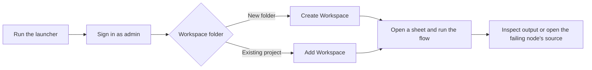

# Phyzflow

Phyzflow is a local application for humans and AI agents to build, run, and inspect Python flows. Each sheet opens a Python flow as an execution graph where you can run the flow, inspect individual nodes, and trace results back to source code.

## Quick start

### Start the local application

1. Install uv and make it available on your PATH. The launcher uses Python 3.12 when creating the repository's `.venv` and installs the local SDK with MCP support. [Install uv](https://docs.astral.sh/uv/getting-started/installation/).
2. From the repository root, run the launcher for your platform.

   **macOS and Linux**

   ```sh
   ./deploy/phyzflow.sh
   ```

   **Windows PowerShell**

   ```powershell
   .\deploy\phyzflow.bat
   ```

3. Open the URL printed in the terminal and sign in as `admin`. On first startup, the terminal also prints the path to the initial password file, which defaults to `~/.phyzflow/admin/initial-password`. [Administrator sign-in and application settings](workspace/README.md#sign-in-to-the-local-phyzflow-application).
4. Select **Create Workspace**, choose a new folder, and open the Workspace from the list. Select **Main**, then **Run flow**. The starter flow returns `{"message": "Hello from Workspace"}`. To register an existing Python flow project, choose **Add Workspace** and select its folder.



The default address is `http://127.0.0.1:18080`. To resolve a port conflict, append `--port 0` to the launcher command and open the new URL printed in the terminal. To save a different address or port, use **Network settings** and restart the app.

### Deploy on Linux with systemd

Install uv on a Linux host running systemd. From the repository root, run the installer as the account that should run Phyzflow and its flows. The installer uses `sudo` to register the system service and enable it at boot. Keep the checkout at the same path so systemd can start the installed application.

```sh
./deploy/phyzflow-systemd.sh
systemctl status phyzflow.service --no-pager
systemctl is-enabled phyzflow.service
curl --retry 5 --retry-connrefused -fsS http://127.0.0.1:18080/login > /dev/null
```

Sign in as `admin` using the initial password in `~/.phyzflow/admin/initial-password` on the deployment account. A new configuration listens on loopback and existing network settings are preserved. Use the loopback address with an HTTPS reverse proxy for remote access, or change the bind address in **Network settings** on an isolated test network.

After updating the checkout, rerun the installer to update Phyzflow and restart the service. Use `sudo journalctl -u phyzflow.service -b` to inspect startup logs and `sudo systemctl restart phyzflow.service` to apply saved network settings.

### Run the ticket example from the CLI

From the repository root, use [uv](https://docs.astral.sh/uv/getting-started/installation/) to install the Phyzflow SDK into a Python 3.12 environment.

```sh
uv venv --python 3.12
uv pip install --python .venv/bin/python ./workspace
.venv/bin/workspace --project workspace-test ui
```

Open the URL printed in the terminal (usually [127.0.0.1:18080](http://127.0.0.1:18080)). Select the **Main** sheet and click **Run flow** to try the sample. Click **+** to create a sheet with its own `flow.py`. After editing Python, use **Reload flow** to refresh that sheet.

To try the dashboard examples, run `.venv/bin/workspace --project workspace-test/sheets-demo ui` and open [Live Counter](workspace-test/sheets-demo/flows/Live%20Counter/README.md) or [Telemetry Control Room](workspace-test/sheets-demo/flows/Telemetry%20Control%20Room/README.md). Select the workflow panel in the **Visualize** drawer.

## Documentation

- [Create, edit, and remove dashboard panels](docs/dashboard-editor.md)
- [Application specification](docs/application-spec.md)
- [MCP tool contract](docs/mcp-tools.md)
- [Feature specs and implementation tickets](.scratch/)
- [macOS launcher and CLI commands for AI agents](workspace/README.md)
- [Sample flows, configuration, and tests](workspace-test/README.md)
- [Deploy the sample flow to Docker on Linux ARM64](workspace-test/deployment-trial/README.md#deploy-and-verify)
