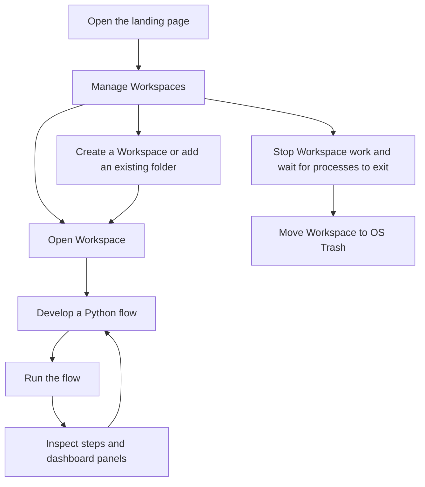

# Phyzflow application specification

Phyzflow is a Python application for developers and AI agents to build, run, and inspect flows. Developers can trace execution step by step and use dashboards authored by an AI agent. The same application supports one-time runs, automation, and continuous workloads operated around the clock.

This specification defines product behavior and the acceptance scenarios for each release. Feature specs and tickets in the [issue tracker](../.scratch/) record implementation scope, dependencies, and status. See the [issue tracker guide](agents/issue-tracker.md) for how those records are maintained.

## Workspace management

**WS-01.** The application opens on a landing page where a developer can create a Workspace, add an existing project folder as a Workspace, and open a Workspace from the list. A Workspace is the project area in which a developer or authorized AI agent develops and runs Python flows.

**WS-02.** Deleting a Workspace stops all its work and waits for its sheet processes and their child processes to exit. Phyzflow then moves the Workspace folder to the host operating system's Trash or Recycle Bin and removes the entry from the Workspace list. Recovery and permanent removal are handled through the operating system.

If work remains running after the stop attempt, keep the Workspace registered and its folder in place. Show that deletion failed because a Workspace process is still running. Direct the user to resolve it through the host OS, for example by ending the process or restarting the host, before retrying Delete. If the OS rejects the move to Trash, show that error and keep the Workspace registered.

**WS-03.** Each Workspace has one Python environment. All its sheets use that interpreter and share its installed dependencies. Provision the environment automatically when creating or adding a Workspace.

Use Python 3.12 and a `.venv` directory at the Workspace root. Create it with uv if it is missing. If an added folder already has a working Python 3.12 `.venv`, reuse it. If it is broken or uses a different Python version, show the detected problem and leave the directory intact so the user can repair or move it before trying again.

## Flow development and inspection

**FLOW-01.** A developer or AI agent declares named steps in Python. A step is a unit of work in the flow, such as `Read Data`, `Validate`, `Transform`, or `Save`. The flow declares how the steps connect.

**FLOW-02.** The application shows execution step by step. A developer can see each step's status and timing and identify the step that raised an error. Step duration measures elapsed time inside calls to the step, including synchronous work it calls. For tracked generators, duration adds the time spent in each call and excludes pauses between yields and resumptions. Step code can report progress and metrics for finer detail during execution.

**FLOW-03.** Each sheet provides a console view for each run. The console displays the run's standard output and standard error in that sheet, with output from concurrent sheets kept separate.

**FLOW-04.** Each sheet has log settings for **Save console logs** and **Retention (days)**. Saving is on by default. Logs contain the sheet's console output and are stored by run. When saving is off, live console output is still available.

Use a default retention of seven days. Rotate saved logs daily so retention also applies to continuous runs. Store them under the sheet's `.workspace/logs/` directory by run ID. The retention setting controls how long saved log segments remain available.

**FLOW-05.** Saved source changes take effect on the next run of the sheet. A run already in progress continues with the source version it started with.

Opening a sheet and saving Python source keep the graph and editors available. Run validates the latest saved source and reports validation failures on the sheet. Reload flow refreshes the graph when the saved source can be loaded. If the source cannot be loaded, Phyzflow shows the last loaded graph or a source preview with editable nodes. The last loaded graph survives an application restart.

**FLOW-06.** Rename a sheet from the Workspace toolbar or through MCP. Persist the name and use it in sheet lists. Apply the same name rules as sheet creation and reject duplicate names. Keep the project path, active runs, history, and dashboard references when a sheet is renamed. The root sheet remains addressable as `Main` by CLI and MCP clients.

**MCP-01.** Every command in the Workspace flow-development scope is available through MCP. This includes working with Python source and dashboard code, validating, running and stopping flows, inspecting execution, and managing the flow's dependencies. MCP clients can discover, edit, and verify saved dashboard assets through MCP. Browser-based visual verification is a separate operation.

**MCP-02.** The Phyzflow instance deployed on the host determines and enforces MCP permissions. Access is scoped to flow development within authorized Workspaces. Modification of the Phyzflow application's specification or implementation belongs outside that access boundary.

**MCP-03.** An administrator manages MCP access in the deployed web application. The administrator selects which Workspaces an MCP identity may access and can revoke those grants. The deployed instance checks the grant for each request.

**MCP-04.** An authorized MCP client can list, read, create, replace, move, and trash regular project files by Workspace-relative path, including project dotfiles. Protect application files, runtime state, Git data, Python environments, and filesystem aliases. Manage Sheet removal through the Sheet lifecycle. Check the current revision and affected Sheet locks on file mutations. A move preserves an existing destination. A deletion uses the host Trash or Recycle Bin.

**MCP-05.** Transfer files as opaque bytes in MCP chunks. Limit each chunk to 512 KiB decoded and determine upload capacity from the destination filesystem and available disk space. Publish an upload only after verifying its size, SHA-256, destination revision, and permissions. Provide a streaming client and reclaim staged files on cancellation, idle expiry, and service restart.

**EDIT-01.** Opening a sheet for editing acquires an exclusive editing lock for that sheet. While the lock is held, other authorized users can open the sheet in read-only mode. Editing through the UI or MCP is exclusive, and other sheets can be opened and edited independently.

**EDIT-02.** MCP is the primary path for acquiring and releasing the sheet editing lock. When an MCP operation finishes, including on failure or cancellation, it must cleanly close the processes it owns for that operation and release its lock when it closes the sheet. Runs handed off to the Workspace are managed by the Workspace under the run lifecycle rules.

**EDIT-03.** If a stuck MCP session or stale lock prevents a sheet from opening for editing, an authorized human user decides whether to force it open. Force open clears the stuck editing session and loads the latest saved source from disk. Unsaved changes from that session are discarded.

Store one editing lock per sheet on the host with the session identity and last heartbeat. A session sends a lightweight heartbeat every 15 seconds, independently of editing activity. Mark the lock as possibly stale after 45 seconds without a heartbeat or as soon as the host detects a disconnected session without clean closure. Keep the sheet read-only for other users until the owner closes it or a user chooses **Force Open**. Show the owner, last heartbeat time, and the effect on unsaved edits before the user decides. Once the user confirms, invalidate the old session's write access, clean up its editing processes, and open the last saved source. A reconnecting session with the old lock can no longer write.

## Administrator access

**AUTH-01.** Each installation has one built-in web administrator account with the username `admin`. Deployment generates a unique initial password for that installation and provides it privately to the installer. The credential remains valid across service restarts and host reboots. Additional web accounts and user management are outside the current release scope.

The administrator signs in to manage Workspaces and issues or revokes MCP tokens through the web application. MCP tokens identify clients and carry the Workspace grants defined in MCP-03.

## Dashboard panels

**DASH-01.** An AI agent can author the visualization code for a dashboard panel. The author can choose visualizations suited to the flow, such as a chart for a reported metric or a status panel for a set of named steps.

**DASH-02.** Dashboard panels follow the current Phyzflow application as the visual and interaction reference. Use the existing [Workspace styling](../workspace/src/workspace_sdk/static/workspace.css), [flow styling](../workspace/src/workspace_sdk/static/app.css), and [Live Counter dashboard](../workspace-test/sheets-demo/flows/Live%20Counter/README.md) when defining and reviewing the shared theme for AI-authored panels.

| Theme area | What the standard must define |
|---|---|
| Color | Palette roles for surfaces, borders, text, and chart series, with consistent colors for run and step states |
| Typography and spacing | Type hierarchy, number and unit formatting, spacing scale, and panel padding |
| Charts and data displays | Treatment of axes, labels, units, legends, tooltips, and missing values |
| Interaction and states | Control styling, keyboard focus, and presentation of loading, empty, live, and error states |
| Panel layout | How panels adapt to resizing and how content behaves when space is limited |

Keep the existing panel structure with `index.html`, `style.css`, and `dashboard.js`. The application supplies a shared base stylesheet derived from the current UI palette, typography, spacing, and state styles. The panel author adds only the styles needed for the visualization. JavaScript receives the run snapshot and reported metrics through the existing [dashboard subscription bridge](../workspace/src/workspace_sdk/static/dashboard-ui.js). Keep panel code in the existing sandbox.

To declare Dashboard Bridge compatibility, add an optional `bridge.json` next to the panel's `index.html`. Set `versions` to a non-empty list of the positive integer versions the panel accepts, for example `{"versions": [1]}`. The Workspace provides version 1 and exposes it as `window.workspaceDashboard.version`. Panels without `bridge.json` use version 1. When the provided version is outside the panel's list, the Workspace displays both versions in that panel and leaves the flow and neighboring panels available. Use `inspect_dashboards` to discover the current bridge version and declaration format.

Use the Live Counter dashboard as the first template. Review a generated panel beside the host UI in idle, live, error, and narrow-panel states. Use the shared theme and the displayed data as the review criteria.

**DASH-03.** The Workspace Dashboard displays selected Workflow and Node dashboard panels from sheets in the same Workspace. Open it from the Workspace toolbar. Each placement references its source sheet, scope, and Panel ID. The sheet owns the dashboard assets. Removing a placement leaves the source panel and its files available in the sheet. Use the existing sandbox and Dashboard Bridge v1.

Display the selected panels together in the full-window Visualize layout. Preserve their placements and saved layout. Show each panel's source sheet and allow users to open that sheet to edit its panel or change its settings. Let the user toggle panels and enter browser full screen for the dashboard or for one panel.

Each panel receives dashboard data scoped to its source sheet, including when the Flow Editor is unopened. Panels can show the active run or latest saved data with the source run ID and timestamp. Live JPEG frames are available only while the sheet is running, and frames stay out of run history. Keep other placements available when a source sheet stops or a source sheet or panel is removed. Workspace placements show operational data without request or response payloads, output previews, samples, console output, or exception text.

**DASH-04.** Create a Workflow or Node dashboard from starter source in the sheet's Visualize drawer. Open the source editor or confirm source removal from the panel's title bar. Saving a source file reloads the preview and rejects changes based on an outdated file revision. Removing a panel in the source sheet deletes its dashboard assets and closes that panel.

## Run types and lifecycle

**RUN-01.** The application can execute all three Python workload patterns below. Flow code owns workload rules such as input and output handling, schedules and triggers, branching on errors, retries, and checkpointing.

| Run type | Behavior |
|---|---|
| One-time | A flow starts on demand and reaches a terminal result. |
| Automation | Python code defines when to wait, what schedule or trigger starts work, and how to handle missed activations. |
| Continuous | A flow stays active while it serves requests, processes incoming data, or performs other ongoing work. |

**RUN-02.** Stopping a Workspace process stops work running in that process. A Workspace process is the application-side process responsible for executing work in that Workspace.

**RUN-03.** After a host reboot, Phyzflow starts automatically with the operating system and restores each job's latest operating state. This rule applies to one-time, automation, and continuous workloads. The startup path works without someone opening the UI or sending a new run command.

| Latest state before reboot | Behavior after startup |
|---|---|
| Running | Start a new run automatically at the first step of the flow. This includes interrupted one-time runs. |
| Active Python process waiting for a schedule or trigger | Start the process again from the first step. The flow code decides when to wait or activate. |
| Stopped by the user | Keep the job stopped until it is explicitly started again. |
| Finished, with success or failure | Keep the terminal state. A completed run does not start again because the host rebooted. |

Shutdown of a running process during reboot preserves the last operating state for restoration. An explicit **Stop** records the stopped state. Jobs that need to reuse earlier results, resume application-level work, or handle repeated side effects must implement that behavior inside their flow.

**RUN-04.** Each sheet runs independently. A developer can start one sheet or use **Run All** to start every idle sheet in the Workspace concurrently. Sheets already running keep their current run. Each sheet has its own run state and console output while using the shared environment. A failure to start or an error in one sheet leaves the other sheets free to start and continue.

**RUN-05.** While the host stays up, Phyzflow restarts an active run from its first step if its execution process terminates unexpectedly. Allow up to three automatic restart attempts after the original start. If all three fail, mark the sheet failed and wait for an explicit Run. The sheet shows its run state. Notifications are deferred. An explicit Stop, Workspace deletion, or a flow reaching a terminal result follows its own lifecycle behavior.

## Deployment

**DEP-01.** Phyzflow supports on-premises and cloud installations for operating Python workloads around the clock.

**DEP-02.** The application supports HTTP and HTTPS. Use direct HTTP on loopback or an isolated test network. For HTTPS, run Phyzflow on loopback and put a [Caddy reverse proxy](https://caddyserver.com/docs/quick-starts/reverse-proxy) in front of it.

- For a public deployment, use a public DNS hostname that points to the proxy and make ports 80 and 443 reachable. Caddy obtains and renews the public certificate.
- For isolated acceptance testing or a private installation, use a private hostname with Caddy's internal CA. Install the CA certificate on each browser or MCP client that connects to that host.
- Verify that a remote client can use the app over HTTPS with ordinary certificate validation and that Phyzflow applies its web and MCP authorization rules.

**DEP-03.** Python flows run with the host OS capabilities and hardware access available to their configured execution account. This includes access to connected boards and peripherals when the host, drivers, and account permissions allow it.

Use a headless installation on each supported host so the application can start before a user logs in.

| Host | Startup design |
|---|---|
| Linux | Install a [systemd service](https://www.freedesktop.org/software/systemd/man/latest/systemd.unit.html), enabled through `systemctl`. Run the service and flows as the user who deployed Phyzflow. |
| macOS | Use a system-level [`launchd` LaunchDaemon](https://developer.apple.com/library/archive/documentation/MacOSX/Conceptual/BPSystemStartup/Chapters/CreatingLaunchdJobs.html) to start the headless backend at boot. |
| Windows | Use [Task Scheduler's startup trigger](https://learn.microsoft.com/en-us/windows/win32/taskschd/schtasks) under a configured account, with the task set to run whether that user is logged on or not. |

**DEP-04.** Run the release scenarios on macOS, Linux, and Windows against an installed backend from a separate client, as with a cloud deployment. Use a VM or a separate host on a private network when it reproduces the relevant conditions. Reboot tests must restart the host. Device tests must run where the configured account can access the actual board or peripheral.

## Release requirements

**REL-01.** Compatibility with projects from earlier Phyzflow versions is outside the current release scope. Acceptance testing uses projects created for the target version.

**REL-02.** Before release, all features agreed in this specification must pass acceptance. A version increment marks the introduction of a new feature. Acceptance for a new version covers both the new feature and the previously agreed behavior.

## Acceptance scenarios

These scenarios describe observable expectations for release acceptance.

| Requirements | Scenario and expected result |
|---|---|
| WS-01 | Create a new Workspace and add a separate existing project folder. Both appear in the landing-page list and open from it. |
| WS-02 | Delete a Workspace while sheet and child processes are running. Verify that the processes exit before the folder moves to the host OS Trash or Recycle Bin, that they stay stopped, and that the Workspace leaves the landing-page list. |
| WS-02 | Make a Workspace process remain active after the stop attempt. Verify that Delete reports the active process, directs the user to the host OS, and keeps the folder and registration in place. Separately verify the error when the OS rejects the move to Trash. |
| WS-03 | Create a Workspace and add another from an existing project folder. Verify that Phyzflow creates an environment for each. Install a dependency in one environment and verify that two sheets in that Workspace can import it using the same interpreter. |
| WS-03 | Add a folder with a valid Python 3.12 `.venv` and verify reuse. Repeat with an incompatible or broken environment and verify that Phyzflow reports the problem and preserves the directory. |
| FLOW-01, FLOW-02 | Run a flow with named steps. Observe step status and timing, then force one step to fail and verify that the error is attributed to that step. Use a step that reports progress and a metric to verify that both are visible. |
| FLOW-03, RUN-04 | Use Run All and verify that every sheet is started and that concurrent outputs appear in their own consoles. Cause one sheet to fail and stop a different sheet. Verify that another running sheet continues. |
| RUN-04 | Start one sheet and record its run ID. Use Run All and verify that the active sheet keeps that ID and that the remaining idle sheets start. |
| FLOW-04 | Run two sheets with the default settings. Turn saving off on one sheet and change retention on the other. Verify that both still show live console output, that the disabled sheet stops creating saved log output, and that the other sheet removes expired daily segments even during a continuous run. |
| FLOW-05 | Save a source change during a run. Verify that the active run completes with its original source behavior and that the next run uses the saved change. |
| FLOW-05 | Save invalid Python while a sheet is ready. Verify that the graph and editor stay available after a browser refresh. Select Run, confirm that the sheet reports the source error, then repair the file from the node and run again. |
| FLOW-05 | Open and run a sheet with invalid Python before its first successful load. Verify that the source preview opens and that Run reports the error. Repair it from a node and run successfully. Restart Phyzflow with the source broken again and verify that its last loaded graph opens before Run. |
| FLOW-06 | Rename a running sheet from the toolbar and confirm its run ID and dashboard source path stay the same. Rename through MCP and verify the updated name after reopening the Workspace. Try a duplicate name and verify it is rejected. |
| DASH-01, DASH-02 | Ask an AI agent to author a panel for a flow metric. Open it in the Workspace and verify the values it displays and its conformance to the current application's theme and interaction conventions. |
| DASH-03 | Add existing panels from two sheets to the Workspace Dashboard and verify their source labels and saved layout after reopening. Open the dashboard and a panel in full screen. Run both sheets without opening their Flow Editors and verify that each panel shows its own run ID, timestamp, and live data. Verify that stopping a sheet clears its live frame and leaves the other panel updating, and that saved runs contain no frames. Reject a reference to another Workspace. Remove one placement and verify that the original panel still opens in its sheet. Remove a source panel from its sheet and verify that only its placement becomes unavailable. |
| DASH-04 | Create a Workflow and a Node dashboard in the Flow Editor and verify that the files are stored in the corresponding sheet scope. Save an HTML edit and verify that the preview and file update. Verify that a stale revision is rejected. Cancel and confirm removal in separate attempts. Removing an Overview from its sheet preserves additional panels. |
| MCP-01, MCP-02 | Verify that each flow-development command is available through MCP. Run representative commands against a Workspace allowed by the deployed instance and one it denies. Verify that the Phyzflow application specification is protected from edits through MCP. |
| MCP-03 | Grant and revoke a Workspace permission in the web app. Verify that the MCP identity gains access after the grant and that its next request is denied after revocation. |
| MCP-04, MCP-05 | Use an authenticated remote MCP client to round-trip a large binary file and verify SHA-256. Exercise file revisions, project dotfiles, cross-Sheet moves, Trash recovery, interrupted transfers, revocation, and protected paths. |
| AUTH-01 | Install two independent instances. Verify that each has one `admin` account and a distinct initial password. Verify that an incorrect password is rejected and that the correct password still works after reboot. Sign in to issue an MCP token scoped to a Workspace. |
| EDIT-01 | Open a sheet for editing. Verify that another authorized user can view it read-only and cannot edit it through the UI or MCP. Verify that the other user can edit a different unlocked sheet. |
| EDIT-02 | Finish an MCP editing operation, then repeat with a failure and a cancellation. Verify that its processes close cleanly and that the lock is released when the sheet closes. Verify that a run handed off to the Workspace follows the Workspace lifecycle. |
| EDIT-03 | Save changes, create a new unsaved draft, and leave an MCP editing session stuck. Verify that recovery waits for a human decision. Have the user force open the sheet and verify that the latest saved source loads and that the stale lock no longer blocks editing. |
| EDIT-03 | Let an idle session continue sending heartbeats and verify that it retains its lock. Stop its heartbeats and verify that the user sees the stale-lock details. After Force Open, verify that the old session cannot write on reconnect. |
| RUN-01 | Run a one-time flow to completion. Run an automation that waits for a trigger implemented in Python and verify that it activates when triggered. Run a continuous flow and verify that it stays active across multiple units of work. |
| RUN-02 | Stop a Workspace process with an active run and verify that work in that process stops. |
| RUN-03 | Reboot during a run of each supported type. Verify that Phyzflow starts with the host and that each active job starts a new run at its first step without input from a user. |
| RUN-03 | Reboot with an active automation waiting in Python code, a manually stopped job, and a finished run. Verify that the automation starts at its first step and follows its own waiting logic, the stopped job stays stopped, and the finished run is not replayed. |
| RUN-05 | Terminate an active sheet's execution process unexpectedly while the host stays up. Verify that Phyzflow starts a new run from its first step. Repeat with an explicit Stop and verify that the sheet stays stopped. |
| RUN-05 | Make the original execution process and all three restarted processes terminate unexpectedly. Verify that the sheet ends in a failed state and starts no fourth retry. |
| DEP-01, DEP-02 | Verify application access over HTTP and HTTPS on the agreed on-premises and cloud targets. Verify automatic startup using each target's service configuration. |
| DEP-03 | On Linux, verify that the service and its flows use the deployment account. On a supported host with a connected board or peripheral, run a Python flow that verifies the device is accessible to the configured execution account. |
| DEP-04 | On macOS, Linux, and Windows, reboot the installed host while a flow is active. Connect from a separate machine over HTTPS, verify the certificate normally, and verify that the application and flow restarted without a login session on the host. |
| REL-01 | Run release acceptance with projects created for the target version. |
| REL-02 | For a version increment, verify that the release introduces a new feature and that its acceptance scenarios and all previously agreed feature scenarios pass. |

## Release test setup

Before executing the release tests, record the exact macOS, Linux, and Windows versions, the test hosts or VMs, the board or peripheral used for device verification, and the hostname used for each HTTPS installation.
