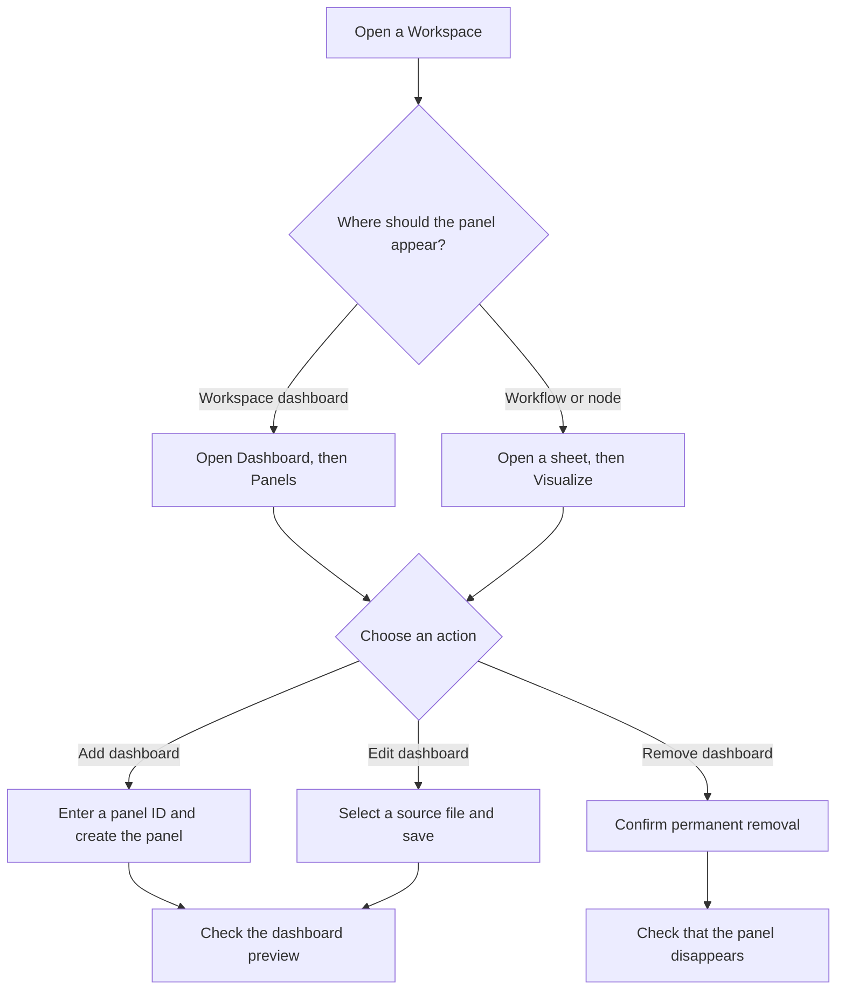

# Edit dashboard panels in Phyzflow

Open a Workspace in the [local Phyzflow application](../README.md#start-the-local-application). Use the Workspace dashboard for a panel that reads across sheets, or open a sheet in the Flow Editor to create a panel for that workflow or one of its nodes.

## Create a panel

1. For a Workspace panel, select **Dashboard** on the Workspace toolbar and open **Panels**. In the Flow Editor, open **Visualize** for the current sheet. If the drawer is hidden, open the panel switcher and select **Visualize**.
2. Select **Add dashboard**. In the Flow Editor, set **Scope** to **Workflow** or select a node by name.
3. Enter a **Panel ID**, such as `run-status`, and select **Create dashboard**. Use letters, digits, periods, underscores, or hyphens, with at least one letter or digit. Each ID must be unique within its scope. The ID `default` is reserved for the Overview.
4. Verify that the new panel opens with a **Dashboard** heading and **Waiting for data…** before a run is available. The Workspace example follows the live status of **Main**. Run **Main** and open the dashboard while the run is active to see the status update. Workflow and node examples display the status from the sheet's run snapshot.

Phyzflow creates `index.html`, `style.css`, `dashboard.js`, and `bridge.json` together. Use [the Dashboard Bridge reference for Workspace panels](../workspace/README.md#build-a-dashboard-from-multiple-sheets) or [the reference for workflow and node panels](../workspace/README.md#build-a-dashboard-for-a-workflow-or-node) to change the data the panel displays.

## Edit a panel

1. Open the panel and select **Edit dashboard** on its title bar.
2. Choose **Source file** and edit the contents. For a quick check, select `index.html` and change the text inside the `<h1>` element.
3. Select **Save**. Look for **Saved.**, then close the editor and verify that the preview shows the new heading. Save each file before switching to another. If a companion file is missing, select it and save your content to create it.

If Phyzflow reports that the file changed on disk, copy any edits you want to keep, reopen the file, and apply your changes to the latest version. If the preview reports a problem with `bridge.json`, open it from **Edit dashboard**, correct the declaration, and save to reload the preview.

## Remove a panel

1. Select **Remove dashboard** on the panel title bar.
2. Check the panel name in the confirmation, then select **Remove dashboard** again to permanently delete its dashboard assets. Verify that the preview closes and the panel disappears from **Panels** or **Visualize**.

To hide a panel, use its **Close dashboard** button when visible or toggle the panel from **Panels** or **Visualize**. Removing the Overview deletes its dashboard assets in the scope folder and preserves panels in the `panels/` subfolder.

## Find the source files on disk

| Scope | Folder for a panel created in the editor |
| --- | --- |
| Workspace | `dashboards/workspace/panels/<panel-id>/` from the Workspace root |
| Workflow | `dashboards/workflow/panels/<panel-id>/` from the sheet folder |
| Node | `dashboards/nodes/<step-id>/panels/<panel-id>/` from the sheet folder |

Overview assets sit directly in the scope folder, one level above `panels/`. The **Main** sheet uses the Workspace root as its sheet folder. For node folder names that need encoding, see the [workflow and node dashboard reference](../workspace/README.md#build-a-dashboard-for-a-workflow-or-node).
