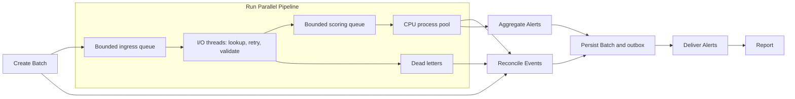

# Telemetry Control Room

A single-computer batch monitor for 12 simulated devices. Open the **Telemetry Control Room**
sheet in the `sheets-demo` Workspace and click **Run flow**. The Run panel shows outcome counts,
alert delivery, and queue and worker metrics. Double-click any graph node to inspect its Python
package. The workload uses the Python standard library and runs in the existing project environment.

After a run completes, select **Run Parallel Pipeline** and open **Execution** in the Node
inspector to compare queue wait times and worker overlap. Selecting a different run in History
shows that run's measurements. The pipeline opts in by calling `workspace_sdk.record_metrics`
from the executing node with fixed stage and metric labels and numeric aggregates. It can report
up to eight groups of eight values per node without enabling input or output samples.

Click **Visualize** in the workflow toolbar to compare node durations. Open **Run Parallel
Pipeline** from that dashboard to see queue and scoring measurements for the same run. Switch
to **Live run** to see prepared readings, queue depth, and the current submission limit. Raise
the input's event count to 1800 to leave time for live controls. Change **Submissions per worker**
and choose **Apply to live run** to update the limit at the next dispatcher iteration, or choose
**Save for next run** to persist the value. Use **Reload dashboard** after editing the files.

From the repository root, using the sheet project's installed SDK:

```sh
cd workspace-test/sheets-demo
.venv/bin/workspace check --sheet 'Telemetry Control Room'
.venv/bin/workspace run --sheet 'Telemetry Control Room' '{"config":{}}'
```

## Execution



- **Create Batch** produces replayable sensor windows from a seed and deduplicates event IDs.
- **Run Parallel Pipeline** has a producer thread, a calibration I/O thread pool, and a
  process pool for CPU-bound reference-profile scoring. The calibration lookup simulates I/O
  delay. The scorer runs actual pure-Python work with a configurable number of rounds.
  Both queues have an exact depth cap. The dispatcher also caps submitted CPU futures at
  the configured submissions per worker times the number of CPU workers. The default is two
  submissions per worker. Upstream producers wait when their queue fills.
- Invalid checksums go straight to dead letters. A simulated transient calibration timeout
  gets up to three attempts with increasing delay. Exhausted attempts also go to dead letters.
- **Reconcile Events** requires exactly one scored or dead-letter outcome for every unique ID.
  **Aggregate Alerts** groups scores by severity and device. The Runner invokes these graph
  nodes in dependency order. Threads and processes overlap inside the pipeline node.
- **Persist Batch** writes the outcome ledger and critical alert outbox in one SQLite transaction.
  **Deliver Alerts** writes to a local SQLite sink and marks the outbox entries in one transaction.
  Replaying identical content reuses the batch and delivers only pending alerts. The queues are
  in memory. Recovery after a restart requires replaying the batch with the same input.
- **Report** returns JSON statistics. Workspace's graph measures node wall time. The report adds
  queue depth, blocked enqueue attempts, worker overlap, and per-event p95 timings. Per-event
  timing starts when the producer first attempts to enqueue that event, and scoring wait includes
  dispatcher and process scheduling time. Queue and future limits bound work in flight. The demo
  also keeps the generated input and result index in memory for batch reconciliation.

## Try a failure

Set `config.simulate` in the Run panel or CLI input:

| Value | Result |
| --- | --- |
| `none` | Default. Includes deterministic per-event retries and dead letters. |
| `score` | A CPU worker raises in `scoring.py`. The pipeline fails and persistence is skipped. |
| `delivery` | The local sink transaction rolls back. The persisted outbox can be delivered by rerunning the same input with `none`. |

Use a fresh seed to see pending alerts before a retry. A second successful replay delivers zero
new alerts. The database is local to this sheet under `.workspace/telemetry.sqlite3`.
Pressing **Stop** during scoring terminates the sheet and its CPU workers. Each CPU worker watches
the lifetime of its parent sheet process. Reload the sheet after editing the scoring code because
spawned processes import the scoring module from disk.

## Measurements on Apple Silicon

Median of three CLI runs per configuration on an 8-core Mac with 16 GB RAM and Python 3.12.
Each run used the same 240 unique events, seed 42, and 320 score rounds. Pipeline time includes
worker startup and shutdown. Throughput includes dead-letter outcomes. The p95 column covers
scored events.

| I/O threads | CPU processes | Queue capacity per stage | Pipeline ms | Events/s | Event p95 ms | Scoring wait p95 ms |
| ---: | ---: | ---: | ---: | ---: | ---: | ---: |
| 1 | 1 | 6 | 1,105 | 217 | 75.9 | 34.6 |
| 4 | 1 | 6 | 1,105 | 217 | 91.7 | 49.3 |
| 4 | 3 | 6 | 442 | 543 | 78.4 | 59.9 |
| 4 | 3 | 1 | 440 | 546 | 62.7 | 15.3 |

The default run removes 21 duplicate records, scores 230 events, and assigns 10 dead letters
(6 invalid checksums and 4 exhausted timeouts). It recovers 18 events after a retry and
produces 14 critical alerts. Four I/O threads feeding one CPU worker fill the scoring queue
more often without raising throughput. Three CPU processes increase throughput by about
2.5 times. With the same worker counts, capacity 1 lowers tail latency in this workload
and keeps throughput similar. A 1,000-event run scored 955 events, recorded 45 dead letters,
and finished the pipeline in about 1.59 seconds.
